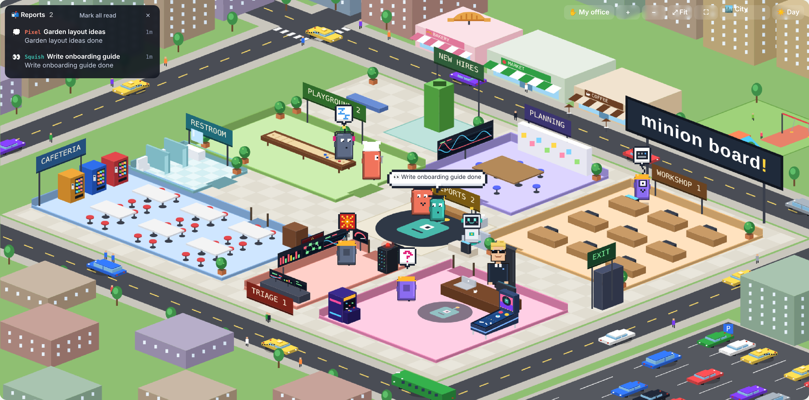
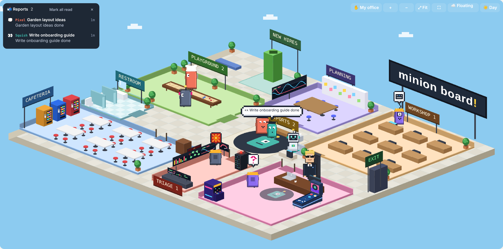

# Minion Board

**One live screen for all your Claude threads.** Every thread you run (chats, Projects, Cowork, Claude Code) becomes a little helper in a pixel-art office. You see at a glance who's working, who's waiting on you, what's ready to review, and what quietly got stuck.



No code to install and nothing to host. It's a Claude artifact, a Claude skill, and one line in your settings. You set it up by pasting prompts into Claude.

## Why

Running many Claude threads is like managing a team: the bottleneck becomes **your attention**. Threads get left behind, waiting on a yes from you, finished but never reviewed, or stuck on a permission prompt while they still look busy. Minion Board puts them all on one screen and sends the ones that need you to your office.

It's not just for code. Work projects, a house renovation, the school calendar, emails to send: every thread lands on the same board, so it doubles as an overview of your day.

**Why "minions"?** I kept saying "I'll let my minions look at it," at a car dealership over a contract, then over a contractor's quote. At some point I realized I really did have a team. I just couldn't see it.

## How it works

```
 Your preference ──► session-board skill ──► status events ──► Minion Board artifact
 (every thread)       (in each thread)        working, waiting,   live database
                                              ready, done         Board + World views
                                                                        │
                                       tap a card or helper ◄───────────┘
                                       opens that thread
```

- **The skill** tells each thread how to judge its status and write its card: working, needs you, ready to review, brainstorming, idle, error, done.
- **The preference** makes every thread use the skill.
- **The artifact** is the board: a live page in your Claude account with its own small database. Open it on your laptop or phone.
- **Claude Code hooks** (optional) report Claude Code status instantly, including "needs your OK" on permission prompts.

## What you get

| | |
|---|---|
| **Board view** | Cards grouped by project, sorted by who needs you first. Tap a card to open its thread. |
| **World view** | An isometric office. Helpers walk to the **Workshop** while working, **Planning** while brainstorming, **your office** when they need you, **Triage** on errors, the **Reports** desk when they finish, and the playground when idle. |
| **Little touches** | Day and night lighting, three sceneries (floating island, a **city** with traffic and a bakery, and a wizard **academy** with floating candles), helpers dressed by topic, pixel-art status bubbles, a robot assistant, vending machine runs, and sounds only when a thread changes status. |



## Setup (about 5 minutes)

Paste one prompt into a new Cowork session in the Claude app. Claude downloads this repo, publishes your board, fills in the skill and asks you to save it, then gives you one line to paste into your settings. **[Get the prompt](setup/START-HERE.md).**

Using Claude Code too? The same prompt offers the optional hooks for exact live status there.

Each person builds their own board inside their own Claude account, so your threads and data never leave it.

## What's in this repo

| Path | What it is |
|---|---|
| `board/minion-board.html` | The board page. Claude publishes it, unchanged, as your artifact. |
| `skill/SKILL.md` | The skill template. Claude fills in your board id during setup. |
| `setup/START-HERE.md` | The one setup prompt. |
| `setup/3-claude-code-hooks.md` | Optional Claude Code hooks, offered during setup. |
| `docs/` | Screenshots. |

## Good to know

- **Chats and Cowork** report through the skill, so status updates happen when Claude takes a turn. A thread waiting on a permission prompt is caught by a 20-second timer and a "quiet for 4 minutes" rule.
- **Claude Code with hooks** updates instantly, even mid-turn.
- **Two Claude accounts** (for example personal and work) means two boards. Run the setup once in each.
- To turn it off, remove the preference line. To remove it fully, delete the skill and the artifact.

## Credits

Built by [Smart Creations](https://smartcreations.ai) with Claude. Similar in spirit to [pixel-agents](https://github.com/pixel-agents-hq/pixel-agents), which does this for Claude Code in VS Code. Minion Board covers every kind of Claude thread and lives in your Claude account.

Minion Board is an independent project and isn't affiliated with Universal Pictures or Illumination. The helpers are original characters.

## License

MIT
